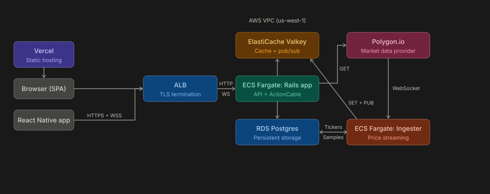

# Steak & Eggs

Backend for [steakneggs.app](https://steakneggs.app/), a paper-trading app with streaming market data, and for [DataCat](https://steakneggs.app/datacat), the monitoring tool built into it.

**Try it:** open [steakneggs.app](https://steakneggs.app/) and press **Try Demo** for an account with $100k, no sign-up needed. DataCat is public.

Frontend repo: [steak-and-eggs-spa](https://github.com/armaaniel/steak-and-eggs-spa)

Mobile app: [steak-and-eggs-mobile](https://github.com/armaaniel/steak-and-eggs-mobile)

Price ingestion: [steak-and-eggs-ingester](https://github.com/armaaniel/steak-and-eggs-ingester)

## Architecture

- **Decoupled streaming pipeline.** A standalone Ruby process (the ingester) holds a WebSocket to Polygon.io and writes prices to Valkey. Rails reads Valkey on demand for REST endpoints and pushes live updates to clients through ActionCable. The two have independent failure domains, scale independently, and the pipeline is push-based end to end.
- **Financial integrity in five layers.** Database transactions, pessimistic row locks, consistent lock ordering, model validations and database check constraints overlap, so if one layer fails, another catches it. Transactions track cost basis and realized P&L.
- **Resilience by design.** Service-layer fallbacks return structured JSON so the frontend renders placeholders instead of breaking. `RedisService.safe_*` wrappers rescue every Redis error. Timeouts bound every external call (Polygon, Redis, Postgres). The ingester reconnects on its own when its connection goes stale or drops. Every error goes to Sentry.
- **Built-in monitoring (DataCat).** Every request writes a trace, which is written off the request path. A canary walks a full user journey every 5 minutes against a 99.5% SLO. CloudWatch metrics cover every dependency, and the ingester reports its own health. k6 load tests are joined to the server's traces by request ID. No external APM.
- **Layered caching with three freshness models.** Continuous overwrite for streaming prices, TTL-only for data the user can't change, and explicit invalidation for state the user can change. On top of that, an in-memory `Rails.cache` serves the user hot path, and `MGET` batches multi-position reads.
- **Cross-platform clients.** The React/TypeScript web app and the React Native mobile app hit the same Rails API. Header-based JWT auth works the same for both.
- **Scheduled jobs.** EventBridge Scheduler starts three Fargate tasks a night (ticker sync, portfolio snapshots, trace pruning), each reusing the app's task definition with a different command.
- **GitHub Actions CI/CD** runs Brakeman and a 355-example RSpec suite on every PR. A merge to `main` deploys to ECS.
- **All AWS infrastructure is provisioned with Terraform.** That covers the VPC, ECS Fargate on ARM64 (the app and the ingester), RDS Postgres 17, ElastiCache Valkey 8.2, the ALB, ECR and EventBridge Scheduler.

## What DataCat Found

DataCat exists to answer real questions about the app. Here's what I measured.

**HTTP capacity.** A price request costs about 0.8 ms of CPU, so throughput levels off at about **308 requests/s**. Server p99 stays under 5 ms up to 200 requests/s and reaches 72 ms at 300.

**Past capacity.** At a 350 requests/s target, the server still answers in about 4 ms (p50), but client p50 rises to 1.2 s. Requests are waiting in line, not being worked on.

**Live price fan-out.** **3,500–4,000 WebSocket messages/s** on the same task, with a median lag of 24–38 ms from publish to a client in Palo Alto. Past that, lag climbs into seconds.

**A health check that took the task down.** During a WebSocket overload test, the canary's sign-up took 79 seconds inside Rails. The ALB's health check timed out, and ECS replaced the task, which later cut every open WebSocket. The health check is deliberately shallow (no Redis or Postgres call), and it still failed, because the process itself was saturated.

## Deep Dive

### Market Data Pipeline

**Polygon.io → Ingester → Valkey → ActionCable → Frontend.** Polygon pushes 15-minute-delayed per-second bars over a WebSocket, for every ticker in the `tickers` table. For each bar, the ingester runs one Redis pipeline that sets `price:<symbol>` and `open:<symbol>` (6-day TTL) and publishes to `price_channel:<symbol>`. ActionCable streams each channel to the clients subscribed to it.

The ingester runs as its own ECS task, so Rails restarts don't drop the Polygon connection, and an ingester crash doesn't affect API requests. Polygon allows one WebSocket per API key, so the ingester deploys with `minimum_healthy_percent = 0`. The old task stops before the new one starts, which costs a few seconds of feed per deploy, and Valkey still holds the last prices.

The ingester knows the market calendar, including holidays and early closes. During trading hours, it checks once a minute for silence, and more than 55 seconds without a message counts as a stale connection and triggers a reconnect. Outside trading hours, silence is expected.

**Telemetry.** The ingester never serves a request, so traces can't see it, and it reports on itself instead. It works out its state from its own thread and the market calendar: booting, connecting, streaming, idle (market closed), stale, dead, backoff or shutdown. It writes a row to Postgres every 60 seconds, and on every state change with the cause: boot, a reconnect after going stale, an error, or the SIGTERM from a deploy. Each row counts frames and events, how late each bar arrived, and how long the ingester spent processing versus waiting. If the write fails, the counts carry into the next row instead of being lost. The samples show prices arriving spread across each second, about 170 frames a second, not in bursts. The lag baseline (15 minutes plus Polygon's 2-second holdback) is the same offset `/livedata` and the Live chart use. DataCat's Ingester page charts these rows, and the details are in the [ingester repo](https://github.com/armaaniel/steak-and-eggs-ingester).

### Financial Integrity

Trades update the user balance, the position row, and a transaction record atomically within a database transaction. Five layers enforce correctness:

1. **Database transactions:** all writes succeed or all roll back.
2. **Pessimistic row locks:** `SELECT ... FOR UPDATE` on the user and position rows prevents lost updates from concurrent trades.
3. **Consistent lock ordering:** always user first, then position, which prevents deadlocks.
4. **Model validations:** balance ≥ 0, shares > 0, quantity/value > 0, case-insensitive username uniqueness.
5. **Database check constraints and unique indexes:** the same rules enforced at the database level, so they can't be bypassed by raw SQL, `update_columns`, or a future rake task.

All monetary values use `BigDecimal` in Ruby and `decimal(17,4)` in Postgres for exact arithmetic.

### Caching Strategy

Cache-aside everywhere, with three deliberately different freshness models:

1. **Continuous overwrite** (streaming data): the ingester overwrites `price:<symbol>` and `open:<symbol>` on every bar. The 6-day TTL is a safety net for long market closures, not the freshness mechanism.
2. **TTL-only** (data the user can't directly affect): market snapshots (5 min), company descriptions (3 days), chart bars (24 h), ticker metadata (1 month). There's no invalidation logic. The next request after expiry refetches.
3. **Explicit invalidation** (user-affected state): positions, portfolio history, activity feed. `CacheService.invalidate_user` clears the affected keys synchronously after every write.

An in-memory `Rails.cache` holds the decoded user object after JWT verification. It's the hottest path, with no network latency. `MGET` batching fetches all position prices in a single Redis round trip for the AUM calculation.

Every Redis call goes through `RedisService.safe_*`, which rescues errors and returns `nil`. Callers then fall through to Postgres or the upstream API, so a Redis outage degrades to slower reads, not 500s.

### DataCat

DataCat is the monitoring tool built into this API. Its dashboard lives in the SPA at [`/datacat`](https://steakneggs.app/datacat) and reads from this app over GraphQL. DataCat answers four questions: is it up, is it fast, why not when it isn't, and how much load can it take.

**Traces (is it fast?).** Service methods wrap their work in `ActiveSupport::Notifications.instrument`, recording each Redis, Postgres and Polygon call as a span. Spans collect per request in a `Concurrent::Map`. When the controller action finishes, the trace goes onto a `Queue` with:
- duration and DB runtime
- status, user and request ID
- error class and location, plus the Sentry event ID
- the spans

A background thread drains the queue once a second and writes the batch with a single `insert_all`. If the process crashes, it loses up to a second of traces, and a failed batch goes to Sentry and is dropped. That's acceptable for monitoring data, and never for trades, which are written inside the request.

**The canary (is it up?).** Every 5 minutes, a k6 script walks the whole journey in 15 steps. It signs up, logs in, deposits, searches, checks a price, buys, sells, withdraws, changes the password and deletes the account, then confirms the old token is rejected. The share of runs that pass is tracked against a 99.5% SLO over 30 days, which allows an error budget of 43 failed runs.

**Synthetic traffic stays separate.** The canary and the load tests send a `Synthetic-Key` header with a source and a run ID. Their traces are tagged, so they never mix with real traffic, and each run can be opened request by request.

**Dependencies (why not?).** `DependencyHealthService` reads CloudWatch metrics for the ALB, both ECS services, RDS and Valkey, and caches them in Valkey. The ingester's own telemetry (see [Market Data Pipeline](#market-data-pipeline)) adds its state, throughput and lag.

**Load tests (how much can it take?).** k6 scripts drive HTTP and WebSocket load and post their results to `/load_samples`, `/cable_samples` and `/run_metrics`. A per-second sampler records CPU and GC stats on the task. Each k6 request is joined to the server's trace by request ID.

**Queries.** Aggregation happens in Postgres: `PERCENTILE_DISC` for exact p50, p95 and p99, and `FILTER` clauses for cache-hit rates and canary pass and fail counts. Trace lists are capped at 1,000 rows. A nightly job deletes traces and ingester samples older than 30 days, in batches of 10,000 with a pause between them. Load-test traces are kept.

### Scheduled Jobs

Three EventBridge Scheduler crons start standalone Fargate tasks. Each reuses the app's task definition with a command override.

- **Ticker sync (4 AM UTC):** upserts the active tickers from Polygon and marks the rest delisted. `DRY_RUN=1` previews the changes.
- **Portfolio snapshots (5 AM UTC, after the US close):** iterates through users in batches of 1,000. Each batch takes five round trips no matter how many users or positions it has: one query for users, one bulk position lookup, one Redis `MGET` for all unique symbols, one `upsert_all` and one bulk cache `DEL`. `upsert_all` with `unique_by: [:user_id, :date]` makes the job idempotent, so retries, reruns and double-fires all converge to the same result. A nested `rescue` isolates per-user errors, so one bad row doesn't stop the snapshot for everyone.
- **Trace pruning (6 AM UTC):** the 30-day cleanup described above.

### Resilience

Every external dependency has a bounded timeout:
- Polygon HTTP calls: 0.5–1 s to connect, 2–2.5 s to read
- Redis: 1 s
- Postgres connections: 2 s

Without these, a slow upstream ties up Puma threads and cascades into a full outage.

Controller actions rescue all exceptions and return structured fallback JSON matching the success shape (`{open: 'N/A', high: 'N/A', ...}`), so the frontend always gets a renderable response. Domain errors map to specific status codes (`InsufficientFundsError` → 402). The ALB health check is deliberately shallow: `GET /` returns `{status: 'ok'}` with no Redis ping and no Postgres query, so a slow dependency doesn't fail the health check and cascade.

### Testing

RSpec covers models, services, requests and channels, with 355 examples across 19 spec files. The tests cover:
- buy and sell correctness: balance debits, position creation and removal, weighted-average recalculation, and realized P&L including losses
- domain error mapping
- Redis cache behavior: hits, misses, TTLs and invalidation
- graceful degradation on `Redis::BaseError`
- REST and WebSocket JWT auth
- input validation

Brakeman runs static security analysis on every PR. All specs run in GitHub Actions.

## Trade-offs

These choices keep a demo app cheap. They're the first things I'd change for real users.

- **No redundancy.** There's one task per service, a single-AZ RDS instance (7-day backups) and a single Valkey node. If one fails, that part is down until AWS or ECS replaces it.
- **Tasks run in public subnets** with public IPs, behind security groups, to avoid paying for a NAT gateway.
- **Ingester deploys cost a few seconds of prices,** because Polygon allows one socket per key. Valkey keeps serving the last prices meanwhile.
- **The trace queue lives in memory,** so a crash loses up to a second of traces.
- **The traffic is mostly mine:** the canary, the load tests and me. The numbers above come from deliberate load, not real users.

## Models

| Table | Description |
|---|---|
| `users` | Auth, balance tracking; has many positions, transactions, and portfolio records |
| `positions` | Symbol, share count, and weighted average cost basis per user |
| `transactions` | Trade history with market price at execution and realized P&L |
| `portfolio_records` | Daily snapshots of portfolio value |
| `tickers` | Symbol reference data (name, exchange, type, currency) and delisted status |
| `traces` | One row per API request, with a JSONB breakdown of its Redis, Postgres and Polygon calls |
| `ingester_samples` | The ingester's state, throughput and lag, every 60 seconds and on every state change |
| `load_samples` | One row per k6 HTTP request, joined to `traces` by request ID |
| `cable_samples` | Per-second WebSocket load-test samples: frames received and their lag |
| `run_metrics` | Server metrics such as CPU, sampled during a load run |

## API

Three surfaces: REST (trading app), WebSocket (live prices via ActionCable), and GraphQL (DataCat). JWT authentication uses the `authToken` header. WebSocket auth uses query params.

| Method | Endpoint | Description |
|---|---|---|
| `POST` | `/signup` | Create account |
| `POST` | `/login` | Authenticate, receive JWT |
| `POST` | `/demo` | Create demo account with $100k |
| `POST` | `/change_password` | Update password |
| `DELETE` | `/delete_account` | Destroy user and all associated data |
| `GET` | `/` | Health check |
| `POST` | `/deposit` | Add funds |
| `POST` | `/withdraw` | Withdraw funds |
| `GET` | `/search` | Ticker search |
| `GET` | `/portfoliochart` | Historical portfolio value |
| `GET` | `/portfoliodata` | Current AUM + positions with live prices |
| `GET` | `/activitydata` | Transaction history |
| `GET` | `/stocks/:symbol/tickerdata` | Ticker reference info |
| `GET` | `/stocks/:symbol/chartdata` | Price chart for a `range` of 1D, 1W, 1M, 3M, YTD, 1Y or 5Y (default 1D) |
| `GET` | `/stocks/:symbol/livedata` | The last minute of per-second bars, to seed the Live chart |
| `GET` | `/stocks/:symbol/companydata` | Market cap + description |
| `GET` | `/stocks/:symbol/marketdata` | Intraday OHLV snapshot |
| `GET` | `/stocks/:symbol/stockprice` | Live price + daily open |
| `GET` | `/stocks/:symbol/userdata` | User's position + balance for symbol |
| `POST` | `/stocks/:symbol/buy` | Execute buy order |
| `POST` | `/stocks/:symbol/sell` | Execute sell order |
| `POST` | `/load_samples`, `/cable_samples`, `/run_metrics` | Load-test results (synthetic key required) |
| `WS` | `/cable` | ActionCable (live price subscriptions) |
| `POST` | `/graphql` | DataCat queries |

**Tech Stack:** Rails 8 · PostgreSQL · Valkey · ActionCable · GraphQL · Polygon.io · AWS (ECS Fargate, RDS, ElastiCache, ALB, EventBridge Scheduler, CloudWatch) · Terraform · k6 · Sentry
